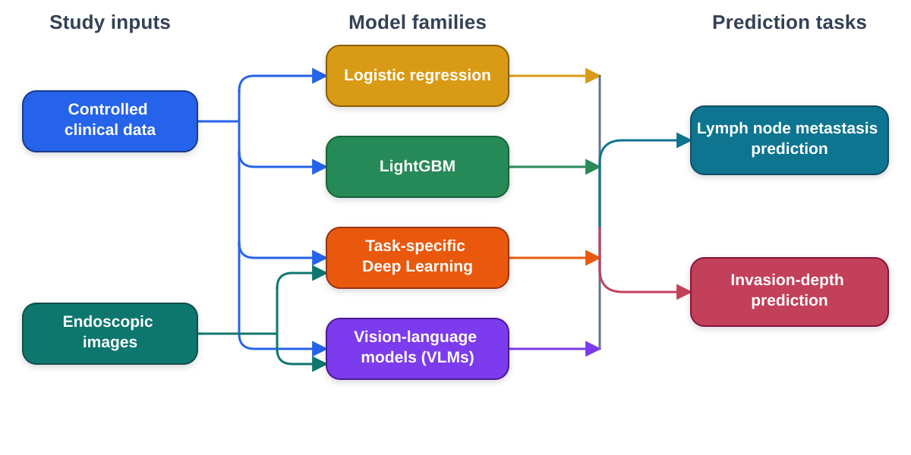

# Clinicopathological heterogeneity, treatment patterns, and AI predictive modelling on early gastric cancer across six longitudinal cohorts

Research code accompanying the manuscript by Ruinian Chen, Jiachen Sun, Yiqun Lin, Zijie Cheng, Boxuan Li, Weiru Wang, Sihua Lan, Yimin Li, Chongju Bao, Genyuan Yang, Hongcai Wang, Shengqiang Zhao, Limian Er, Yukun Zhou, and Yi Lu.

This repository contains the model-training and validation framework used to evaluate logistic regression and LightGBM, and to benchmark task-specific deep learning and vision-language models, for lymph node metastasis (LNM) and invasion-depth prediction in early gastric cancer (EGC).

## Highlights

- Multicentre retrospective study of 2,039 patients contributing 2,081 lesion-level records across six centres in China.
- Binary prediction of LNM and T1b submucosal invasion, plus three-class invasion-depth prediction (M, SM1, and SM2&3).
- Internal cross-validation, external validation, feature ablation, bootstrap comparison, and fixed-threshold performance evaluation.
- Comparison of image-only, clinical-text-only, and multimodal inputs for task-specific deep learning and four vision-language models.



## Scope of this release

The repository covers the predictive-modelling components associated with Figure 5, Figure 6, Figure 7, and their related extended-data analyses. It includes model training and validation, feature ablation, bootstrap comparisons, performance evaluation, checkpoint-safe inference, and VLM benchmarking.

It does not include individual-level clinical data, endoscopic images, generated predictions, model checkpoints, manuscript figure-layout code, or the descriptive cohort and treatment-pattern analysis used for Figures 1–4. See [Reproducibility notes](docs/REPRODUCIBILITY.md) for the detailed coverage map.

## Repository structure

```text
.
├── code/
│   ├── Invasion_Depth/
│   │   ├── Deep_learning_binary/
│   │   ├── Deep_learning_multiclass/
│   │   ├── LightGBM_binary/
│   │   ├── LightGBM_multiclass/
│   │   ├── Logistic_Regression_binary/
│   │   ├── Logistic_Regression_multiclass/
│   │   ├── VLM_Claude4.8/
│   │   ├── VLM_Gemini3.5/
│   │   ├── VLM_GPT5/
│   │   └── VLM_MedGemma/
│   └── Lymph_Node_Metastasis/
│       ├── Deep_learning/
│       ├── LightGBM/
│       ├── Logistic_Regression/
│       ├── VLM_Claude4.8/
│       ├── VLM_Gemini3.5/
│       ├── VLM_GPT5/
│       └── VLM_MedGemma/
├── data/README.md
├── docs/REPRODUCIBILITY.md
├── .env.example
├── .gitignore
├── CITATION.cff
├── LICENSE
└── requirements.txt
```

## Getting started

### 1. Create the environment

Python 3.11 is recommended.

```bash
conda create -n egc-ai python=3.11 -y
conda activate egc-ai
pip install -r requirements.txt
```

For an NVIDIA system using CUDA 12.1, install the matching PyTorch wheels first:

```bash
pip install torch==2.5.1 torchvision==0.20.1 --index-url https://download.pytorch.org/whl/cu121
pip install -r requirements.txt
```

Deep-learning scripts download the BiomedCLIP weights through `open-clip-torch` when required. Traditional models can run on CPU. Deep-learning experiments require substantially more compute; a minimum GPU-memory requirement has not been benchmarked for this release.

### 2. Prepare data

The study data are not distributed with this repository. The scripts request local tabular-data and, where applicable, image-directory paths at runtime.

The experiments use a controlled internal development dataset. Logistic-regression and LightGBM models additionally use a separate external dataset for validation; task-specific deep-learning and VLM experiments use their prespecified internal image-available analysis sets. See [Reproducibility notes](docs/REPRODUCIBILITY.md#dataset-roles) for details.

See [Data access](data/README.md) before adapting the code to another cohort. Do not place patient data, images, credentials, generated predictions, or checkpoints in version control.

### 3. Run a model

Each script is independently executable and prompts for the required paths. Examples:

```bash
# LightGBM feature ablation for binary invasion-depth prediction
python code/Invasion_Depth/LightGBM_binary/train_lightgbm_t1ab_ablation.py

# Logistic-regression internal training and external validation for LNM
python code/Lymph_Node_Metastasis/Logistic_Regression/validate_logistic_lnm_external.py

# Task-specific deep learning for three-class invasion depth
python code/Invasion_Depth/Deep_learning_multiclass/train_deep_learning_invasion_multiclass.py

# GPT-5 benchmarking for LNM
python code/Lymph_Node_Metastasis/VLM_GPT5/vlm_gpt5_lnm.py
```

## Model families

| Family | Tasks | Evaluation |
|---|---|---|
| Logistic regression | LNM, binary invasion depth, three-class invasion depth | Five-fold internal evaluation and separate external-validation scripts |
| LightGBM | LNM, binary invasion depth, three-class invasion depth | Five-fold internal evaluation and separate external-validation scripts |
| Task-specific deep learning | LNM, binary invasion depth, three-class invasion depth | Five-fold evaluation with image-only, tabular-only, and multimodal inputs |
| Vision-language models | LNM and binary invasion depth | Image-only, clinical-text-only, and multimodal benchmarking |

Exact model configurations, preprocessing, output formats, and comparison procedures are defined in the scripts.

## Vision-language model configuration

Credentials and deployment details are read only from environment variables. The code does not load `.env` files automatically; `.env.example` is a reference list.

```bash
export OPENAI_API_KEY="..."
export ANTHROPIC_API_KEY="..."
export GEMINI_API_KEY="..."

export MEDGEMMA_GCP_PROJECT_NUMBER="..."
export MEDGEMMA_GCP_LOCATION="..."
export MEDGEMMA_ENDPOINT_ID="..."
export MEDGEMMA_ENDPOINT_DOMAIN="..."
```

VLM execution can incur provider charges and depends on access to the model identifiers and endpoints specified in the scripts. API behaviour and model availability may change over time.

## Data availability

The individual-level clinical data and endoscopic images are not publicly available because of patient-privacy and institutional data-governance requirements. De-identified data may be available upon reasonable request and subject to institutional approval. Data-access requests should be directed to Yi Lu at [luyi45@mail.sysu.edu.cn](mailto:luyi45@mail.sysu.edu.cn).

## Citation

The citation metadata will be updated after publication. Until then, please cite the associated manuscript:

```bibtex
@unpublished{chen2026egc,
  title  = {Clinicopathological heterogeneity, treatment patterns, and AI predictive modelling on early gastric cancer across six longitudinal cohorts},
  author = {Chen, Ruinian and Sun, Jiachen and Lin, Yiqun and Cheng, Zijie and Li, Boxuan and Wang, Weiru and Lan, Sihua and Li, Yimin and Bao, Chongju and Yang, Genyuan and Wang, Hongcai and Zhao, Shengqiang and Er, Limian and Zhou, Yukun and Lu, Yi},
  year   = {2026},
  note   = {Manuscript}
}
```

## Responsible use

This repository is provided for research and reproducibility. It is not a medical device and must not be used for clinical diagnosis or treatment decisions without appropriate validation, governance, and regulatory review.

## License

Unless otherwise noted, original material in this repository is available under the [Creative Commons Attribution-NonCommercial 4.0 International License](LICENSE) (CC BY-NC 4.0). The licence does not apply to patient data, endoscopic images, model-provider services, pretrained weights, or other third-party material. Commercial use requires separate permission from the relevant rights holders.

## Contact

For research and data-access enquiries, contact [Yi Lu](mailto:luyi45@mail.sysu.edu.cn). For modelling enquiries, contact [Yukun Zhou](mailto:yukun.zhou@ucl.ac.uk).

Repository structure adapted from the [HORIZON research template](https://github.com/HORIZONHealthcare/research-template).
